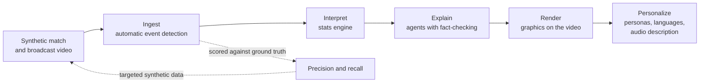

# The Ninety Labs

**AI that watches the match, logs every event, and describes it to every fan, including the ones who can't see it.**

The Ninety Labs is an entry for the Microsoft x Premier League *Inside the Game: Developer Hackathon*
(challenge: *The Synthetic Match Insights Engine for Premier League Studio*). It starts one step
earlier than an event feed: from **video**. A computer-vision pipeline watches a synthetic
broadcast and detects every event automatically. Its output is scored against hidden ground-truth
data, explained by a team of agents, drawn back onto the footage as on-screen graphics, and
personalized for every viewer, including live audio description for blind and low-vision fans.

All clubs, players and matches are synthetic. No real match data or footage is used.

## Why

Football event data is still typed by hand. Opta assigns three analysts per match, StatsBomb two
per match with delivery inside 12 hours, and contract taggers are paid around $70 a match to log
up to 3,000 actions ([Rest of World, 2026](https://restofworld.org/2026/fifa-world-cup-ai-data-workers/)).
Humans also disagree: providers' shot locations differed by more than five yards on 30% of shots
at the 2018 World Cup ([ASA](https://americansocceranalysis.com/home/2019/9/30/shots-in-the-dark-how-data-providers-tell-us-different-versions-of-what-happened)).
That cost is why data stops at the top flight. Downstream, every viewer gets the same on-screen graphics,
and blind and low-vision fans depend on human describers available in only some stadiums.

## How it works



Full design, agent roles and deployment: [docs/ARCHITECTURE.md](docs/ARCHITECTURE.md).

## Documentation

| Document | Contents |
|---|---|
| [BRIEF](docs/BRIEF.md) | the challenge brief and judging rubric |
| [ARCHITECTURE](docs/ARCHITECTURE.md) | design rules, system and agent diagrams, Azure deployment, technology decisions |
| [PLAN](docs/PLAN.md) | goals, timeline, milestones, day-by-day schedule |
| [CHALLENGE_MAP](docs/CHALLENGE_MAP.md) | every requirement of the brief, where it is built, and its status |
| [EVALUATION](docs/EVALUATION.md) | how every published number is measured |
| [ENGINE](docs/ENGINE.md) | how the match engine makes football: agents decide, physics happens, the referee observes |
| [DATA_CONTRACT](docs/DATA_CONTRACT.md) | what ground-truth data must contain, and the validator that checks it |
| [GROUNDING](docs/GROUNDING.md) | every football rule and physical limit, with its source in the Laws of the Game or sports science |
| [LESSONS](docs/LESSONS.md) | mistakes this project already made, the rule now, and how to check; every tool reads it first |
| [SECURITY](SECURITY.md) | rules for a public repo and a public demo |
| [AGENTS](AGENTS.md) | rules for AI coding tools (Copilot, Cursor, Claude Code) |
| [Broadcast render guide](docs/guides/broadcast-render.md) | rendering the synthetic video and generating images |

## Repo layout

| Path | What lives there |
|---|---|
| `ninety/sim` | Seeded match engine: events + per-frame positions (the ground-truth data) |
| `ninety/render` | Broadcast camera, player bodies, ground-truth labels, render checks, train/test split |
| `web/render` | Broadcast-style three.js renderer that turns a sim run into video |
| `ninety/vision` | Detection, tracking, camera-to-pitch mapping, possession, event rules |
| `ninety/intel` | Deterministic stats engine (code computes every number) |
| `ninety/agents` | Agent Framework workflow: Analyst, Tactician, Fact-checker, Producer, Personalizer, Describer |
| `ninety/mcp` | MCP server exposing match tools to the agents; Foundry calls it at `/mcp` on the API |
| `ninety/eval` | Grades automatically detected events against the ground-truth data |
| `schemas` | JSON Schemas: match event, frame, on-screen graphic |
| `web` | Viewer: video + overlays + persona controls |
| `infra` | `azd` / Bicep for Azure Container Apps |

## Quick start

```bash
uv sync
uv run ninety-sim --seed 7 --minutes 5 --out runs/seed7
uv run pytest

# broadcast clip with ground truth: one seed, one command (needs Node 22 for three.js)
npm ci --prefix web && uv run playwright install chromium   # once
uv run ninety-render --seed 7 --seconds 10 --out runs/clip7 --mp4   # --mp4 needs ffmpeg

# thin slice: Analyst -> fact-checker over MCP on Foundry, then speech
# (live runs need az login and a role on our Azure project)
uv run ninety-slice --minute 2 --plant
```

**Agents live in Foundry.** The Analyst and the Judge are published to our Foundry project as
versioned prompt agents (`ninety-analyst`, `ninety-judge`), each with the `ninety-guardrail`
content-safety policy: Microsoft's default filters plus Prompt Shields for jailbreaks and indirect
attacks. A live run calls the versions pinned in `ninety/agents/foundry_agents.json` and refuses to
start if the code has changed since they were published; CI checks the same. The Analyst reads
the match only through our MCP server, which Foundry calls itself at `/mcp` on the deployed API,
sending a key it holds in a project connection (the key lives in Key Vault, never in the repo). The
served matches (`seed7`, `seed21`, `seed33`) are simulated when the image is built, so a tool call
is a lookup. Each claim is one
trace in Foundry's tracing view: the agents' calls, the MCP tool calls, and every fact-checking
verdict with its reasons. After changing an agent's prompt, schema or tools:
`NINETY_FOUNDRY_RESOURCE_ID=... uv run ninety-agents publish` (see `ninety/config.py`).

**Running the slice without our Azure project.** Nothing here uses an API key: Azure checks who
is calling (your `az login` locally, the app's managed identity in the cloud), and key access is
off on our resources. A live run from your own clone will therefore fail to authenticate. Replay
a recorded run instead:

```bash
uv run ninety-slice --replay replays/slice-minute2-plant.json
```

Replay swaps only the two Foundry agents for what they answered when recorded: the Analyst's
replies and the Judge's verdicts. The Agent Framework workflow, the handoffs and the code checks
all run for real, so you see the planted number rejected and each rewrite checked until one is
accepted or the claim is held back (the committed recording, one real run, ends held back). If a prompt has
changed since the recording, the replay stops rather than pair an old answer with a new question. Speech needs Azure, so `--speak` does not
replay. Team members refresh the recording with
`uv run ninety-slice --minute 2 --plant --record replays/slice-minute2-plant.json`.

## Status

Working toward **M1, end to end on one clip (Oct 20)**. Running today: the seeded match engine,
the broadcast renderer with exact ground truth and render checks in CI
([decision 0001](docs/decisions/0001-synthetic-data.md)), data contracts, CI and the deploy pipeline. See [docs/PLAN.md](docs/PLAN.md). This README
describes the design; measured results are published in [docs/EVALUATION.md](docs/EVALUATION.md)
as they land.

## License

MIT. Detection uses Apache-2.0 / MIT models only (no AGPL dependencies) so the project stays MIT.
