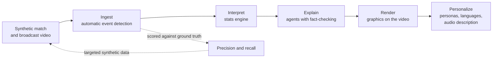

# The Ninety Labs

**AI that watches the match, logs every event, and describes it to every fan, including the ones who can't see it.**

The Ninety Labs is an entry for the Microsoft x Premier League *Inside the Game: Developer Hackathon*
(challenge: *The Synthetic Match Insights Engine for Premier League Studio*). It starts one step
earlier than an event feed: from **video**. A computer-vision pipeline watches a synthetic
broadcast and detects every event automatically. Its output is scored against hidden ground-truth
data, explained by a team of agents, drawn back onto the footage as on-screen graphics, and
personalized for every viewer, including live audio description for blind and low-vision fans.

All clubs, players and matches are synthetic. No real match data or footage is used.

That is the design. What runs and is measured today, and what is still being built, is in
[Status](#status).

## Why

Football event data is still typed by hand. Opta assigns three analysts per match, StatsBomb two
per match with delivery inside 12 hours, and contract taggers are paid around $70 a match to log
up to 3,000 actions ([Rest of World, 2026](https://restofworld.org/2026/fifa-world-cup-ai-data-workers/)).
Humans also disagree: providers' shot locations differed by more than five yards on 30% of shots
at the 2018 World Cup ([ASA](https://americansocceranalysis.com/home/2019/9/30/shots-in-the-dark-how-data-providers-tell-us-different-versions-of-what-happened)).
That cost is why data stops at the top flight. Downstream, every viewer gets the same on-screen graphics,
and blind and low-vision fans depend on human describers available in only some stadiums.

## How it works



Full design, agent roles and deployment: [docs/ARCHITECTURE.md](docs/ARCHITECTURE.md).

## Documentation

| Document | Contents |
|---|---|
| [BRIEF](docs/BRIEF.md) | the challenge brief and judging rubric |
| [ARCHITECTURE](docs/ARCHITECTURE.md) | design rules, system and agent diagrams, Azure deployment, technology decisions |
| [PLAN](docs/PLAN.md) | goals, timeline, milestones, day-by-day schedule |
| [CHALLENGE_MAP](docs/CHALLENGE_MAP.md) | every requirement of the brief, where it is built, and its status |
| [Video script](docs/video-script.md) | the 2-minute demo video beat by beat, what each shot needs, and the submission checklist |
| [EVALUATION](docs/EVALUATION.md) | how every published number is measured |
| [ENGINE](docs/ENGINE.md) | how the match engine makes football: agents decide, physics happens, the referee observes |
| [DATA_CONTRACT](docs/DATA_CONTRACT.md) | what ground-truth data must contain, and the validator that checks it |
| [GROUNDING](docs/GROUNDING.md) | every football rule and physical limit, with its source in the Laws of the Game or sports science |
| [LESSONS](docs/LESSONS.md) | mistakes this project already made, the rule now, and how to check; every tool reads it first |
| [SECURITY](SECURITY.md) | rules for a public repo and a public demo |
| [AGENTS](AGENTS.md) | rules for AI coding tools (Copilot, Cursor, Claude Code) |
| [Broadcast render guide](docs/guides/broadcast-render.md) | rendering the synthetic video and generating images |

## Repo layout

| Path | What lives there |
|---|---|
| `ninety/sim` | Seeded match engine: events + per-frame positions (the ground-truth data) |
| `ninety/render` | Broadcast camera, player bodies, ground-truth labels, render checks, train/test split |
| `web/render` | three.js renderer that turns a sim run into broadcast and whole-pitch tactical video |
| `ninety/vision` | Detection (RF-DETR Small fine-tuned on our renders), the camera fit to the pitch markings (per frame on the broadcast, once per clip on the two fixed tactical views), tracking, team sides, events from possession, the join of the two cameras, and the live detection job |
| `ninety/intel` | Deterministic stats engine (code computes every number) |
| `ninety/agents` | Agent Framework workflow on Foundry: the multi-agent graph (Analyst, Tactician, Challenger, fact-checking agent with the Judge, Producer), the slice (Analyst and Judge), the live path to overlay cues; the phone's match Companion and Insight Scout; the Vision Auditor (offline, code-written; its model path not yet recorded) and the Data agent (code). The Personalizer is `ninety/personalizer` |
| `ninety/speech` | The Describer: audio description from fact-checked lines only, within 2 s of the play, placed in stereo; SSML and WebVTT; Azure AI Speech behind `--speech azure` |
| `ninety/mcp` | MCP server exposing match tools to the agents; Foundry calls it at `/mcp` on the API |
| `ninety/match` | Detected events: the one loader the live path uses; it refuses ground truth |
| `ninety/eval` | Grades detections and detected events against the ground-truth data; the fact-checker evaluation |
| `schemas` | JSON Schemas: match event, frame, on-screen graphic, agent trace, viewer question and answer |
| `web` | `web/render`: the broadcast and tactical renderer. `web/viewer`: the big screen (a streaming player: video, graphics on the footage, match mode, the audio menu; `?dev=1` keeps the persona switch and the agent trace). `web/phone`: the phone companion (radar, Insights, Ask, read-aloud) |
| `infra` | `azd` / Bicep for Azure Container Apps |

## Quick start

```bash
uv sync
uv run ninety-sim --seed 7 --minutes 5 --out runs/seed7
uv run pytest

# broadcast clip with ground truth: one seed, one command (needs Node 22 for three.js)
npm ci --prefix web && uv run playwright install chromium   # once
uv run ninety-render --seed 7 --seconds 10 --out runs/clip7 --mp4   # --mp4 needs ffmpeg

# thin slice: Analyst -> fact-checker over MCP on Foundry, then speech
# (live runs need az login and a role on our Azure project)
uv run ninety-slice --minute 2 --plant
```

**Agents live in Foundry.** The Analyst and the Judge are published to our Foundry project as
versioned prompt agents (`ninety-analyst`, `ninety-judge`), each with the `ninety-guardrail`
content-safety policy: Microsoft's default filters plus Prompt Shields for jailbreaks and indirect
attacks. A live run calls the versions pinned in `ninety/agents/foundry_agents.json` and refuses to
start if the code has changed since they were published; CI checks the same. The Analyst reads
the match only through our MCP server, which Foundry calls itself at `/mcp` on the deployed API,
sending a key it holds in a project connection (the key lives in Key Vault, never in the repo). The
served matches (`seed7`, `seed21`, `seed33`) are simulated when the image is built, so a tool call
is a lookup. Each claim is one
trace in Foundry's tracing view: the agents' calls, the MCP tool calls, and every fact-checking
verdict with its reasons. After changing an agent's prompt, schema or tools:
`NINETY_FOUNDRY_RESOURCE_ID=... uv run ninety-agents publish` (see `ninety/config.py`).

**Running the slice without our Azure project.** Nothing here uses an API key: Azure checks who
is calling (your `az login` locally, the app's managed identity in the cloud), and key access is
off on our resources. A live run from your own clone will therefore fail to authenticate. Replay
a recorded run instead:

```bash
uv run ninety-slice --replay replays/slice-minute2-plant.json
```

Replay swaps only the two Foundry agents for what they answered when recorded: the Analyst's
replies and the Judge's verdicts. The Agent Framework workflow, the handoffs and the code checks
all run for real, so you see the planted number rejected and each rewrite checked until one is
accepted or the claim is held back (the committed recording, one real run, is accepted on its third draft). If a prompt has
changed since the recording, the replay stops rather than pair an old answer with a new question.
The recording also holds the match events the live run checked against, so a change to the match
engine does not break the replay; it only warns that the recording is stale. Speech needs Azure, so `--speak` does not
replay. Team members refresh the recording with
`uv run ninety-slice --minute 2 --plant --record replays/slice-minute2-plant.json`.

## Status

Audited against `main` at `ea7743a8` on Oct 25, 2026; [docs/CHALLENGE_MAP.md](docs/CHALLENGE_MAP.md)
has every requirement with its status (built, partial or planned). The match engine is frozen at
`65247ba3` (#276). The demo plays seed 8080, a 4-1 condensed to 16.9 minutes: Kian chose it after
seeing the pre-registered rule's result, including when the goals came; the rule's pick was seed
8076, and both are recorded in [demo-match.md](docs/eval/demo-match.md).

**Measured on `main`:**

| What | Number | Evidence |
|---|---|---|
| Broadcast detector (ours-freeze), test set of 30 clips, 7,500 frames | ball recall 0.884 (95% 0.877 to 0.891), player recall 0.997 | [finetune-v2freeze](docs/eval/finetune-v2freeze/PLAN.md) |
| Ball mostly hidden, same detector and test set (still the weakness) | recall 0.425 (229 / 539, 95% 0.384 to 0.467) | [finetune-v2freeze](docs/eval/finetune-v2freeze/PLAN.md) |
| Tactical-view detector (ours-tactical), adopted by the pre-registered rule, test set of 28 clips | ball recall 0.692 (963 / 1,392, 95% 0.667 to 0.716), player recall 0.998 | [finetune-tactical](docs/eval/finetune-tactical/RESULTS.md) |
| Broadcast player tracks paired with the same man on the tactical views, 7 validation clips | 144 / 179 paired (80.4%, 95% 74 to 86%); 4 / 144 pairs wrong (2.8%, 95% 1 to 7%) | [association.md](docs/eval/association.md) |
| Passes detected from pixels, frozen test set's five clips | on today's `main`, strict F1 0.25 (2 of 13 found, 1 false): the camera-trust band (#270) rejects most right frames on the test set's older renderer. The earlier 0.67 (7 of 13) no longer holds. Both are below the 0.70 target | [camera-cuts-plan.md](docs/eval/camera-cuts-plan.md), [detector-plan.md](docs/eval/detector-plan.md) |
| Possession changes in open play, same clips | 1 of 5 found, none false | [possession-change.md](docs/eval/possession-change.md) |
| False claims aired, live ablation on held-out seeds | one agent 7 / 10, the multi-agent graph 1 / 24 | [ablation-agents.md](docs/eval/ablation-agents.md) |
| Planted false claims kept off air by the fact-checking agent, on `ninety-judge:1` | 136 / 136, of which 9 held by a Judge service error (127 / 127 where a check decided); 7 / 105 true claims wrongly rejected. Re-run on the current Judge pending | [fact-checker.md](docs/eval/fact-checker.md) |
| Hidden-stat claims on the phone, code checks only, freeze match seed 8076 (an author's test) | 4,318 / 4,318 planted false claims caught, 0 / 596 true claims stopped | [insight-claims.md](docs/eval/insight-claims.md) |
| Team sides confident enough to air a team claim (gate 0.96) | almost none: of 81 held claims on validation, 80 on an unsure side; a second look resolved 0 / 81 | [re-perceive.md](docs/eval/re-perceive.md) |
| Team distance on the phone | shown with ±21%, the worst five-minute bin over four freeze matches | [team-distance.md](docs/eval/team-distance.md) |
| Personalizer over A2A, live evaluation (not yet in the demo path or deployed) | ninety-personalizer:1 run of 21 Oct, now stale (a newer version is published, not measured): the report counts 19 claims above tables of 20 requests per row (8 rows, 160 variants); p95 4.6 s (equal to the maximum) in a 6 s budget; 137 / 160 variants passed the re-check and aired | [personalizer.md](docs/eval/personalizer.md) |
| Read-aloud in the pinned neural voice, pre-generated (not yet in the deployed Replay bundle) | 0.54 s p50, 0.85 s p95 a line | [speech-latency.md](docs/eval/speech-latency.md) |

**Runs on `main`:** the seeded match engine; the broadcast and two fixed whole-pitch tactical
views, rendered with exact ground truth and render checks in CI
([decision 0001](docs/decisions/0001-synthetic-data.md)); frozen test sets and the data contract;
vision from pixels to events, with the tactical views giving the players and the broadcast the ball
and the events; the live detection job for one clip (built, not deployed); the stats engine and the
hidden stats; the multi-agent graph with the fact-checking agent in the demo bundle (`ninety-e2e`,
replayable without Azure); the Personalizer over A2A (evaluated live; off in `ninety-e2e` and not
deployed).

**Ships in the image every green `main` deploys:** the API, the match MCP server, the viewer (match
mode, graphics drawn on the footage, analyst, casual and audio-description personas) with its
Replay bundle (the M1 clip, seed900001, built before the pinned voice and the Insights cards, so it
carries neither), and the phone companion (radar, player cards, Ask; read-aloud in the device's voice).

**Not yet, or not measured:**

- The Companion's own sentences: the committed live run (v2) aired no model sentence; of its 32
  answers, 24 were code's verified sentence and 8 code's "unanswerable" reply ([companion-tools.md](docs/eval/companion-tools.md)). The v3
  run is not committed; v4, where the model chooses among code's checked sentences, is not on
  `main` and its evaluation is pending.
- Event detection at the 0.70 target; the camera-trust band re-derived for the test set's renderer.
  Shot outcomes are in an open pull request; following camera cuts is built but off (it fits a
  reverse angle as the main camera's mirror).
- The highlights reel: built and tested on hand-made events (#287), with its filter and fan labels
  off until the shot-flight measurement runs.
- Team sides good enough to air most team claims (a spatial side model is built, #283, but its sides are right for about 0.75 of tracks on validation and its confidence does not separate right from wrong, so the 0.96 gate still holds back most team-named claims).
- The demo match rendered, with its render checks and its detected events.
- Player tags on the video, player cam, recaps, a voice per language, the 2-minute video.
- The ball when mostly hidden (recall 0.425, above); validation seed 2044, whose broadcast camera
  fit is about 14 m wrong in every frame ([gate-b3.md](docs/eval/gate-b3.md)).
- Known engine gaps at the freeze: too much sideways passing, long shots taken with no defender
  screening the goal, no change of ends at half-time (and `ninety/sim/touches.py` and
  `ninety/render/edit.py` do not yet treat `half_time` as a stop), and one seed's keeper
  acceleration ([issue #297](https://github.com/KLKH7/the-ninety-labs/issues/297)). See
  [docs/CHALLENGE_MAP.md](docs/CHALLENGE_MAP.md).

## License

MIT. Detection uses Apache-2.0 / MIT models only (no AGPL dependencies) so the project stays MIT.
