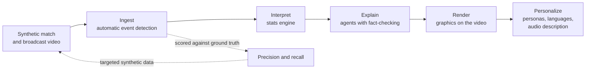

# The Ninety Labs

**AI that watches the match, logs every event, and describes it to every fan, including the ones who can't see it.**

The Ninety Labs is an entry for the Microsoft x Premier League *Inside the Game: Developer Hackathon*
(challenge: *The Synthetic Match Insights Engine for Premier League Studio*). It starts one step
earlier than an event feed: from **video**. A computer-vision pipeline watches a synthetic
broadcast and detects every event automatically. Its output is scored against hidden ground-truth
data, explained by a team of agents, drawn back onto the footage as on-screen graphics, and
personalized for every viewer, including live audio description for blind and low-vision fans.

All clubs, players and matches are synthetic. No real match data or footage is used.

## Why

Football event data is still typed by hand. Opta assigns three analysts per match, StatsBomb two
per match with delivery inside 12 hours, and contract taggers are paid around $70 a match to log
up to 3,000 actions ([Rest of World, 2026](https://restofworld.org/2026/fifa-world-cup-ai-data-workers/)).
Humans also disagree: providers' shot locations differed by more than five yards on 30% of shots
at the 2018 World Cup ([ASA](https://americansocceranalysis.com/home/2019/9/30/shots-in-the-dark-how-data-providers-tell-us-different-versions-of-what-happened)).
That cost is why data stops at the top flight. Downstream, every viewer gets the same on-screen graphics,
and blind and low-vision fans depend on human describers available in only some stadiums.

## How it works



Full design, agent roles and deployment: [docs/ARCHITECTURE.md](docs/ARCHITECTURE.md).

## Documentation

| Document | Contents |
|---|---|
| [BRIEF](docs/BRIEF.md) | the challenge brief and judging rubric |
| [ARCHITECTURE](docs/ARCHITECTURE.md) | design rules, system and agent diagrams, Azure deployment, technology decisions |
| [PLAN](docs/PLAN.md) | goals, timeline, milestones, day-by-day schedule |
| [CHALLENGE_MAP](docs/CHALLENGE_MAP.md) | every requirement of the brief, where it is built, and its status |
| [EVALUATION](docs/EVALUATION.md) | how every published number is measured |
| [SECURITY](SECURITY.md) | rules for a public repo and a public demo |
| [AGENTS](AGENTS.md) | rules for AI coding tools (Copilot, Cursor, Claude Code) |

## Repo layout

| Path | What lives there |
|---|---|
| `ninety/sim` | Seeded match engine: events + per-frame positions (the ground-truth data) |
| `web/render` | Broadcast-style three.js renderer that turns a sim run into video |
| `ninety/vision` | Detection, tracking, camera-to-pitch mapping, possession, event rules |
| `ninety/intel` | Deterministic stats engine (code computes every number) |
| `ninety/agents` | Agent Framework workflow: Analyst, Tactician, Fact-checker, Producer, Personalizer, Describer |
| `ninety/mcp` | MCP server exposing match tools to the agents |
| `ninety/eval` | Grades automatically detected events against the ground-truth data |
| `schemas` | JSON Schemas: match event, frame, on-screen graphic |
| `web` | Viewer: video + overlays + persona controls |
| `infra` | `azd` / Bicep for Azure Container Apps |

## Quick start

```bash
uv sync
uv run ninety-sim --seed 7 --minutes 5 --out runs/seed7
uv run pytest

# thin slice: Analyst -> fact-checker over MCP on Foundry, then speech (needs az login and access to the project)
uv run ninety-slice --minute 2 --plant
```

## Status

Working toward **M1, end to end on one clip (Oct 20)**. Running today: the seeded match engine,
data contracts, CI and the deploy pipeline. See [docs/PLAN.md](docs/PLAN.md). This README
describes the design; measured results are published in [docs/EVALUATION.md](docs/EVALUATION.md)
as they land.

## License

MIT. Detection uses Apache-2.0 / MIT models only (no AGPL dependencies) so the project stays MIT.
