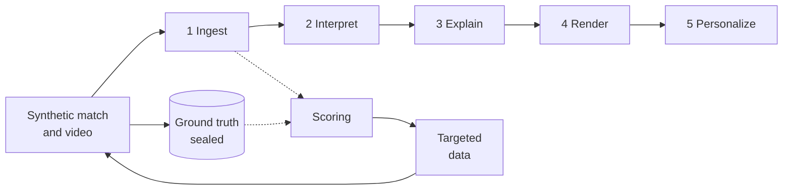
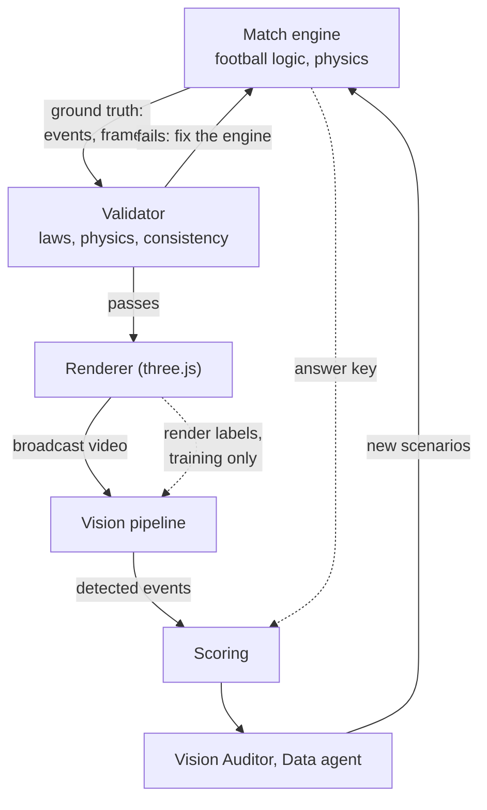
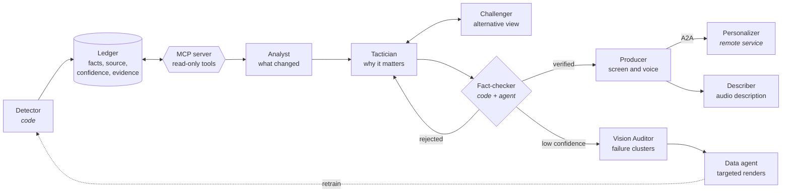
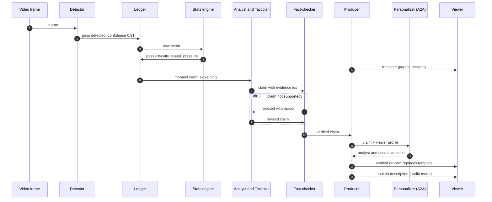
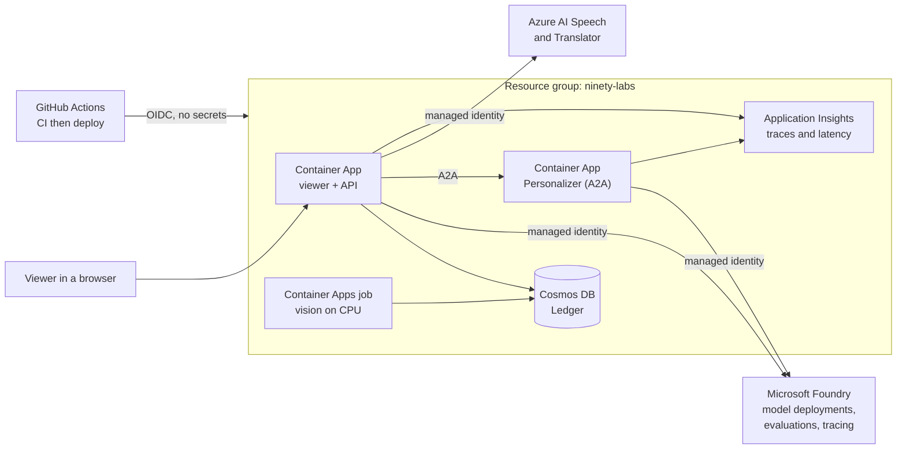

# Architecture

The Ninety Labs turns synthetic broadcast video into explained, personalized match intelligence.
This document describes the system as designed. What already runs is tracked in
[CHALLENGE_MAP.md](CHALLENGE_MAP.md); the delivery schedule is in [PLAN.md](PLAN.md).

## Contents

1. [Design rules](#design-rules)
2. [System overview](#system-overview)
3. [Synthetic data pipeline](#synthetic-data-pipeline)
4. [Agent design](#agent-design)
5. [One moment, end to end](#one-moment-end-to-end)
6. [Deployment on Azure](#deployment-on-azure)
7. [Technology decisions](#technology-decisions)
8. [Data contracts](#data-contracts)

## Design rules

1. **Code computes every number. Models only explain.** Agents read typed facts with ids; the
   fact-checking agent rejects any sentence whose numbers or entities are not in the evidence.
2. **Facts before words.** Every insight is a timestamped fact before it becomes text, so one fact
   renders to any persona or language without recomputing.
3. **Scored perception.** The simulator's ground-truth data is never visible downstream. It is used
   only by `ninety/eval` to score what the vision pipeline produced.
4. **Nothing waits on a model.** A template graphic airs the moment an event is detected; the
   verified graphic replaces it in the same slot.
5. **Every failure has a fallback.** Model outage, remote agent down or low vision confidence
   degrade the output; they never stop it.

## System overview

The five stages named in the challenge brief, with the scoring loop that sets this project apart.

| Stage | What happens | Code |
|---|---|---|
| Synthetic data | a seeded match engine plays the match; a broadcast renderer turns it into video and records exact ground truth | `ninety/sim`, `ninety/render`, `web/render` |
| 1 Ingest | detection, tracking and camera-to-pitch mapping turn the video into events (automatic event detection) | `ninety/vision` |
| 2 Interpret | pass distance, accuracy and difficulty, ball and shot speed, sprint speed, xG, control vs chaos | `ninety/intel` |
| 3 Explain | agents explain why a moment matters; the fact-checking agent gates every claim | `ninety/agents` |
| 4 Render | timed on-screen graphics drawn on the video at detected positions | `web`, `schemas/overlay_cue.schema.json` |
| 5 Personalize | analyst, casual, favourite club, player cam, languages, audio description | `ninety/agents`, `web` |
| Scoring | detected events are scored against the sealed ground truth: precision and recall per event type | `ninety/eval` |
| Targeted data | where detection fails, more footage of exactly that situation is generated, then scored again | `ninety/sim`, `web/render` |

## Synthetic data pipeline

How a match becomes video with known truth, and how failures in vision turn into new data.
Solid lines run every time; dotted lines are the answer key, which only training and scoring
may read.

Every check in the validator, and every rule the engine follows, cites its source: a Law of
the Game, a sports-science measurement or a published match statistic ([GROUNDING.md](GROUNDING.md)).

| Part | Job | Code | Status |
|---|---|---|---|
| Match engine | **makes** the match: applies football logic and physics every 1/25 s and writes each frame and event | `ninety/sim` | running, physics gaps |
| Ground truth | the engine's output: the synthetic data itself | `events.jsonl`, `frames.jsonl` | running |
| Validator | **inspects** the output, independently of the engine's code: a clip that breaks a law, physics or its own events never reaches the renderer | `ninety/validate.py` | running, engine fails it today |
| Renderer | draws the frames as broadcast video; decides nothing about football | `web/render`, `ninety/render` | running |
| Render labels | each player's and the ball's box, projected through the camera, so labels are exact | `web/render` | running |
| Vision pipeline | sees pixels only: detection, tracking, camera-to-pitch mapping, event rules | `ninety/vision` | planned |
| Scoring | compares detected events with the answer key: precision and recall per event type | `ninety/eval` | planned |
| Vision Auditor, Data agent | find where vision fails and ask the engine for more of exactly those scenes | `ninety/agents` | Data agent and the queue-driven render job running; Vision Auditor planned |

The engine and the validator are separate on purpose. The engine encodes *how to make* a
moment happen; the validator encodes *what must be true* of the result. Written independently
from the same source, a bug in one is caught by the other, and a law the engine does not model
yet shows up as a failing check, which is the engine's to-do list.

## Agent design

Each agent has one job and reads and writes a shared, versioned Ledger. Code agents are
deterministic; model agents run on Microsoft Foundry deployments and are orchestrated with
Microsoft Agent Framework.

| Agent | Kind | Reads | Writes | On failure |
|---|---|---|---|---|
| Detector | code | video frames | detected events with confidence | event marked low confidence |
| Analyst | model | Ledger via MCP tools | candidate moments | template graphic only |
| Tactician | model | moment + stats | explanation with cited evidence ids | template graphic only |
| Challenger | model | explanation + evidence | alternative explanation | skipped |
| Fact-checker | code + model | claim + evidence + confidence | verdict | claim held back |
| Producer | code | verified claims | graphic and voice schedule | template graphic only |
| Personalizer | model, remote (A2A) | verified claim + viewer profile | per-persona text | in-process default persona |
| Describer | model + Speech | verified events | spoken description | short code-written line |
| Vision Auditor | model | low-confidence and mismatched events | failure clusters | skipped |
| Data agent | code | failure clusters | render parameters for new scenes | skipped |

## One moment, end to end

What happens between a pass on screen and the graphic and spoken line that explain it.

## Deployment on Azure

All resources live in one resource group. Services authenticate with managed identity, and
GitHub deploys with OpenID Connect, so no key or secret is stored in the repo or in GitHub.

The public demo has two modes. **Replay** serves a cached match and costs nothing per view.
**Live** re-runs the agents and speech on the demo clip and is passcode-gated. A $20 monthly
budget alert covers the subscription. See [SECURITY.md](../SECURITY.md).

**The phone companion** ([`ninety/api/companion.py`](../ninety/api/companion.py)) runs in the
same API Container App. The laptop pairs (`POST /api/pair`, a 6-character code valid for 2 hours),
and the phone joins a WebSocket room at `/api/pair/{code}` (a typed code first reads its clip from
`GET /api/pair/{code}`). A refused join is accepted and then closed with its code, since a browser
never sees a close sent before the accept. uvicorn speaks WebSocket through the locked `websockets`
package; without one it answers the relay with 404. The laptop's clock and focus messages
are relayed to the phone, which reads the minimap, player cards and the wind map (`flow`) over HTTP
and asks questions at `/api/ask`. Rooms, rate limits and the model budget are held in memory. That
works because the app runs as one replica (`maxReplicas: 1` in `infra/main.bicep`). A second
replica would need a shared store or session affinity first. A scale-to-zero restart forgets every
room, and the laptop pairs again.

`NINETY_COMPANION` decides what it serves. Unset or `on`, as deployed, the routes are mounted and
serve only tracked positions: the M1 clip (seed900001), the clip the laptop plays, from its
tracked frames file (`tests/fixtures/tracked-seed900001.json`, written by
`ninety/vision/tracked_frames.py` from the tracks of `ninety/vision/track.py`). The tracker reads
no shirt numbers, so a tracked player's id is its team plus track id (`h-t12`), never a squad id;
the schemas take squad ids only from ground truth and track ids only from tracked positions. A clip
whose positions are ground truth gets a 503, so the live path
never reads the answer key. Until the tracked file exists, pairing that clip answers 503 too.
`standin`, for local work, also serves the simulator's matches, labelled `source: truth`. `off`
mounts nothing.

## Technology decisions

| Area | Decision | Reason |
|---|---|---|
| Renderer | three.js scene driven by `ninety-sim`, captured headless with Playwright at 1280x720, 25 fps; Python computes the camera and body geometry, the page draws it and counts an object-id pass | exact camera matrix per frame and visibility counted from what was drawn ([decision 0001](decisions/0001-synthetic-data.md)) |
| Frame data | compact JSON lines per clip today (about 4.4 KB a frame); Parquet (pyarrow) planned for long clips | a 90-minute match was 180 MB as JSON lines |
| Clip length | 2 to 5 minutes | render and training time |
| Detection | RF-DETR (Apache-2.0) fine-tuned on our renders; ByteTrack via supervision (MIT) | permissive licences only |
| Camera-to-pitch mapping | keypoint heatmap model (PyTorch) trained on render keypoints; homography with RANSAC (OpenCV) | labels come free from the renderer |
| Team assignment | kit-colour clustering on player crops; referee as a third cluster | simple and reliable on synthetic kits |
| Event detection | possession state machine on pitch coordinates; one rule per event type with a confidence | measurable, explainable |
| Training compute | Apple GPU (MPS) or free Colab | no GPU quota assumed |
| Agents | Microsoft Agent Framework (Python); each agent published to Foundry as a versioned prompt agent with a content-safety guardrail, and called by its pinned version | multi-agent orchestration with handoffs and recovery; what ran is visible and versioned in Foundry |
| Shared state | Ledger in Cosmos DB (free tier) | one versioned record every agent reads |
| Agent tools | MCP server, read-only, hosted at `/mcp` on the API and called by Foundry with a Key Vault key | standard tool interface, safe by construction; tool calls run server-side in Foundry |
| Personalizer | separate Container App over A2A, in-process fallback | a real process boundary |
| Speech | Azure AI Speech neural voices with SSML; stereo position from ball x in the browser | audio description |
| Viewer | Vite + TypeScript; video with a canvas overlay synced to the graphics timeline | graphics drawn on the footage |
| Observability | OpenTelemetry to Application Insights; Foundry tracing | latency and failure evidence |
| Infrastructure | Bicep + `azd`; GitHub Actions with OIDC | one-command deploy, no secrets |
| Not used | Event Hubs, Fabric, GPU | cost and scope for a 14-day build |

## Data contracts

The schemas are the interface between the two build tracks. Changing one needs agreement in the
pull request.

| Schema | Describes | Produced by | Consumed by |
|---|---|---|---|
| [`match_event.schema.json`](../schemas/match_event.schema.json) | one event, from ground truth or detected (`source`, `confidence`) | match engine, vision | stats engine, agents, scoring |
| [`frame.schema.json`](../schemas/frame.schema.json) | positions at one frame | match engine, renderer, tracker | renderer, scoring |
| [`overlay_cue.schema.json`](../schemas/overlay_cue.schema.json) | one timed on-screen graphic (optional `pan` and `speech` for a spoken cue) | Producer, Personalizer, Describer | viewer, WebVTT export |
| [`viewer_question.schema.json`](../schemas/viewer_question.schema.json) | a question typed on the phone companion (data, never instructions) | phone companion | Companion agent |
| [`viewer_answer.schema.json`](../schemas/viewer_answer.schema.json) | the answer the phone shows; its number is computed by code | Companion agent | phone companion |
| [`companion_message.schema.json`](../schemas/companion_message.schema.json) | server to phone: `clock`, `focus`, `answer`, `player_card` or `flow` (a team's velocity per cell, for the wind map) | API ([`ninety/api/companion.py`](../ninety/api/companion.py)) | phone companion |
| [`minimap.schema.json`](../schemas/minimap.schema.json) | a clip's downsampled positions for the phone's minimap, with `source` | API | phone companion |
| [`agent_trace.schema.json`](../schemas/agent_trace.schema.json) | one step of the on-screen agent trace | agent workflow | viewer |

The agents' typed contracts in Python (moments, explanations, reviews, profiles, descriptions,
questions, answers, the model callables and `status_for`, the one mapping from a fact-checker
verdict to a claim's status) are in [`ninety/agents/contracts.py`](../ninety/agents/contracts.py);
the question, answer and trace dataclasses mirror their schemas, and `tests/test_schemas.py`
holds them to it.

What a ground-truth clip must contain, and the validator that checks it: [DATA_CONTRACT.md](DATA_CONTRACT.md).
