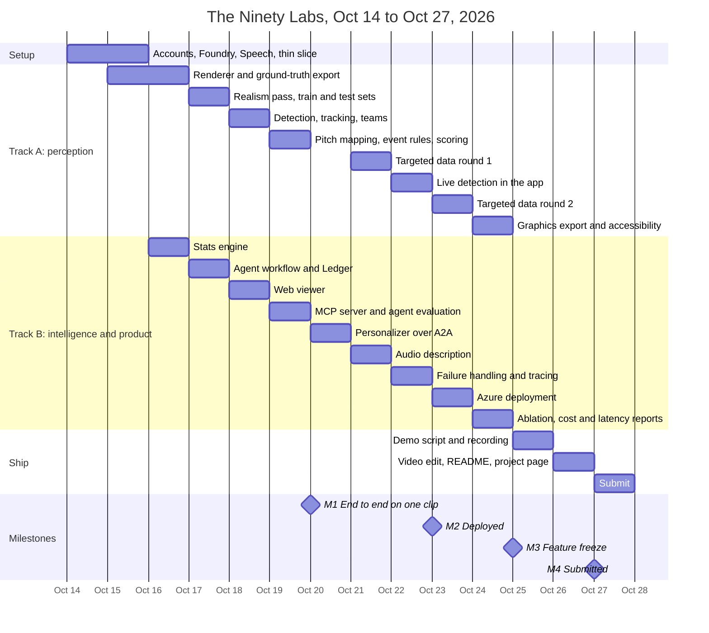

# Delivery plan

Fourteen days, two parallel tracks, four milestones. Submission closes **Tuesday Oct 27, 2026 at
11:59 pm PT**; we submit by **12 pm PT** that day. The design is in
[ARCHITECTURE.md](ARCHITECTURE.md); how each number is measured is in [EVALUATION.md](EVALUATION.md).

## Contents

1. [Goals](#goals)
2. [Timeline](#timeline)
3. [Milestones](#milestones)
4. [Day-by-day schedule](#day-by-day-schedule)
5. [Evidence we publish](#evidence-we-publish)
6. [Experience bar](#experience-bar)
7. [Demo video](#demo-video)
8. [Building in public](#building-in-public)
9. [Scope control](#scope-control)
10. [Risks](#risks)
11. [Ways of working](#ways-of-working)

## Goals

Every target is measured by code in this repo, and every number in the README comes from a file
CI produced.

| Area | Target |
|---|---|
| Vision on 720p broadcast video (blur, camera moves, crowded areas) | player recall ≥ 0.95; ball recall ≥ 0.90 when the ball is at least half visible, and reported for partly hidden, mostly hidden, in-air and blurred balls too; **pass F1 ≥ 0.70 (the headline number)**; shot recall ≥ 0.85; possession accuracy ≥ 90%; speed error ≤ 1.5 km/h. All under the strict matching rules in [EVALUATION.md](EVALUATION.md#vision-scoring), with the lenient rules reported alongside |
| A test set worth scoring | before it is frozen (Oct 18), at least 5% of test frames with the ball in shot have it less than half visible (set pieces, crowded boxes) |
| Automatic event detection | runs live in the app on the demo clip |
| Targeted synthetic data | at least two rounds, each with before and after scores on a fixed, separate test set |
| Fact-checking | catches ≥ 95% of planted false claims; holds back claims built on low-confidence detections |
| Multi-agent proof | ablation of one agent with every tool against the full workflow; four injected failures, all recovered |
| Latency | event to verified graphic p95 ≤ 8 s; event to spoken description p50 ≤ 2 s, p95 ≤ 4 s |
| Cost | ≤ $0.50 per match in model and speech spend, logged |
| Experience | graphics drawn on the video at detected positions; analyst, casual and player cam views side by side; keyboard navigation and reduced motion; passes the [five-second test](#experience-bar) |
| Operations | `azd up` works from a clean clone; green `main` deploys automatically; the demo stays live until Nov 10 |

## Timeline

## Milestones

| Milestone | Date | Done when |
|---|---|---|
| **M1** End to end on one clip | Tue Oct 20 | video → detected events → stats → agents → graphics → viewer runs locally on one clip |
| **M2** Deployed | Fri Oct 23 | `azd up` from a clean clone works; green `main` deploys; the live smoke test passes |
| **M3** Feature freeze | Sun Oct 25, 6 pm | bug fixes only from here; all evidence files committed |
| **M4** Submitted | Tue Oct 27, 12 pm PT | submission confirmed; the demo stays live until Nov 10 |

If M1 slips, the [cut list](#scope-control) is applied the same day.

## Day-by-day schedule

Work is split into two tracks that meet only at the [data contracts](ARCHITECTURE.md#data-contracts).
The agents start on the simulator's ground-truth events and switch to detected events at M1, so
neither track waits for the other. Each item is owned by one of the five roles in [TEAM.md](TEAM.md), which also lists the handoff dates.
"Learn first" is studied in the one to two hours before the work that needs it.

| Date | Track A: perception | Track B: intelligence and product | Learn first | Done when |
|---|---|---|---|---|
| Wed Oct 14 | Team accounts, repo running locally, Copilot | Foundry project and small chat model deployment; Speech resource | Azure basics; Foundry projects and deployments | every teammate runs `uv run pytest`; a script gets a reply from the Foundry deployment |
| Thu Oct 15 | Renderer v1: pitch, players, ball, broadcast camera following the ball | Thin slice: Analyst and Fact-checker agents over five events, MCP server, Speech, tracing | three.js projection, Playwright capture; Agent Framework agents and workflows; MCP | a 10-second clip renders; the slice rejects a planted false claim and the trace shows it |
| Fri Oct 16 | Ground truth from the renderer: camera matrix, boxes, visibility, keypoints; Parquet; render checks | Stats engine on ground-truth events | pyarrow; [render guide](guides/broadcast-render.md) checks | render checks pass in CI; stats tested against hand-computed cases |
| Sat Oct 17 | Realism pass and randomization; ~20 training clips and a fixed 5-clip test set | Agent workflow v1: Analyst, Tactician, Challenger, Fact-checker, Producer; Ledger | Agent Framework handoffs, shared state, checkpoints; Cosmos DB | one clip produces verified graphics from simulator events |
| Sun Oct 18 | RF-DETR fine-tuned on renders; ByteTrack; team clustering | Web viewer v1: video, graphics overlay, persona switch, agent trace | RF-DETR fine-tuning; supervision | detector recall measured on the test set; the viewer plays a clip with graphics |
| Mon Oct 19 | Pitch keypoints and homography; ball track across frames (fills hidden and blurred frames); possession and event rules; scoring report v1 by difficulty | MCP server on real match state; agent evaluation with planted false claims | OpenCV homography; Foundry evaluations | `vision-report-v1` committed; fact-checker catch rate measured |
| **Tue Oct 20 · M1** | Detected events feed the agents | Personalizer as a separate service over A2A; personas and two languages | A2A; Container Apps | M1 done-when met |
| Wed Oct 21 | Vision Auditor and Data agent; targeted round 1; retrain | Describer: audio description, stereo position, latency logging | Speech SSML and streaming; Translator | round 1 shows a before and after; spoken descriptions with p50 and p95 logged |
| Thu Oct 22 | Detection runs live in the app on the demo clip | Confidence gating; outage switch; four injected failures; OpenTelemetry | OpenTelemetry and Application Insights | failure table shows four of four recovered |
| **Fri Oct 23 · M2** | Targeted round 2; final vision numbers | Bicep and `azd`; managed identity; deploy workflow with live smoke test | `azd`, Bicep, Container Apps jobs | M2 done-when met |
| Sat Oct 24 | Graphics export (WebVTT and audio track); accessibility | Ablation; evaluation history; cost per match | none | ablation and failure tables committed |
| **Sun Oct 25 · M3** | Bug fixes only | Demo script and shot list; record every shot from the deployed app | none | script locked; footage captured |
| Mon Oct 26 | Video edit | README numbers, challenge map, project page | none | video uploaded; project page drafted |
| **Tue Oct 27 · M4** | Final check of demo link and budget | Submit by 12 pm PT | none | submission confirmed |
| Oct 28 to Nov 10 | Judging: no breaking changes to `main`; watch uptime and budget | | | demo live until Nov 10 |

## Evidence we publish

Each file is generated by code and linked from the README.

| File | Shows |
|---|---|
| `docs/eval/vision-report-v{n}.json` | precision and recall per event type, speed error, per targeted round |
| `docs/eval/fact-checker.md` | planted false claims caught; claims held back for low confidence |
| `docs/eval/failure-table.md` | four injected failures, the fallback taken, latency |
| `docs/eval/ablation.md` | one agent with every tool against the full workflow |
| `docs/eval/latency-cost.md` | p50 and p95 to graphic and to speech; cost per match |
| Agent workflow diagram | generated from the running workflow |

## Experience bar

Being grounded is not enough: a fan has to get it at a glance. Dense panels of correct facts
fail as television.

- **The five-second test:** someone who has never seen the app looks at any screen for five
  seconds and can say what just happened and why it matters. Test it on a person outside the
  team before calling a view done.
- **One idea on screen at a time.** One graphic per moment, a headline of at most about
  12 words, one number. Detail is one tap or key away, never on screen by default.
- **Ask the match answers like a commentator.** Two sentences at most, plain words, then the
  evidence behind it on demand (the events and numbers it used).
- **The video is the star.** Graphics sit on the footage at the players they describe;
  panels and tables are for the analyst view only.
- **Nothing raw on screen:** no event ids, field names, tool names or internal scores in the
  casual view.

## Demo video

Under two minutes, about 215 words, every shot from the deployed app, no third-party trademarks
or copyrighted music.

| Time | Shot |
|---|---|
| 0:00 to 0:15 | The problem; detected events beside ground truth with live precision and recall |
| 0:15 to 0:35 | A targeted data round raises recall |
| 0:35 to 1:00 | Agent trace: a challenge, a rejection, a regenerated graphic; analyst and casual versions |
| 1:00 to 1:15 | Screen dark: audio description only |
| 1:15 to 1:40 | Graphics on the video, player cam, two languages; a failure injected and recovered |
| 1:40 to 2:00 | Results and the Microsoft stack, with links |

## Building in public

We post progress while we build, with our faces in it, for reach and so the judges can see
real people behind the work.

- **What:** short clips of what runs (a rendered clip with its labels, a rejected claim, a
  before and after score), plus who we are and why we are building it.
- **When:** at each milestone and whenever something new runs; at least two posts before
  the deadline.
- **Rules:** synthetic footage only; no Premier League, club or sponsor marks, and no
  copyrighted music; every number shown comes from a committed evaluation file; never show
  the demo passcode, keys or Azure resource names; show results, not the plan, until the
  submission is in.

## Scope control

Cut from the top when behind schedule.

1. Second camera angle and weather randomization
2. Third language
3. Targeted data round 2
4. Foundry-hosted A2A endpoint (keep A2A through the SDK), then the remote Personalizer (keep it in-process)
5. Cosmos DB (in-memory Ledger behind the same interface)

**Never cut:** measured vision numbers, the confidence-aware fact-checker, audio description, the
deployed demo, the failure table, the video.

## Risks

| Risk | Mitigation |
|---|---|
| Detector trained on real footage does not transfer to renders, or renders are too easy | fine-tune on our renders (labels are exact); keep a hard, separate test set; render checks in CI |
| No GPU quota | train on an Apple GPU or a rented GPU machine (RunPod, Lambda, Colab), synthetic renders only, deleted after the run; run inference on CPU over short clips |
| Region limits | the student subscription allows five regions; everything runs in North Central US, which offers our models |
| Preview features change (A2A, Foundry agents) | every remote piece has an in-process fallback behind the same interface |
| Budget | scale to zero, cached Replay mode, passcode on Live mode, $20 alert |
| Scope | M1 on Oct 20 is the gate; apply the cut list the same day if it slips |
| An easy test set inflates every vision number | score by difficulty; hold the test set to the occlusion floor in Goals before freezing it; report strict and lenient matching side by side |

## Ways of working

- A short check-in each evening: what shipped, tomorrow's done-when, blockers.
- Every change goes through a pull request; CI (lint, tests, schema smoke test, secret scan) must
  pass; Copilot reviews; merge the same day.
- The schemas are the contract between roles; changing one follows [TEAM.md](TEAM.md#contracts).
- A [challenge map](CHALLENGE_MAP.md) row is marked done only when it runs in the demo.
- Rules for every coding tool are in [AGENTS.md](../AGENTS.md).
