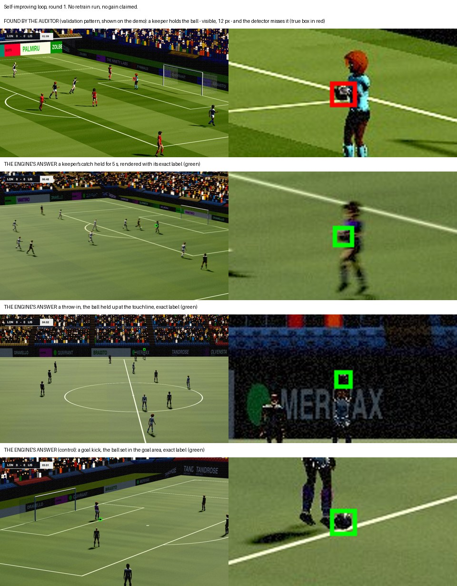

# Self-improving loop, round 1: the Vision Auditor's finding and the engine request

**No retrain was run, and no gain is claimed.** This round is the loop's first half: the auditor
finds where the ball detector fails on validation, the request asks the engine for those scenes,
and the engine renders them with exact labels. Training on them, and measuring the result, is the
next round.

The rule was fixed before any count, in [ball-audit-plan.md](ball-audit-plan.md). The numbers are
in [ball-audit.json](ball-audit.json), from
`uv run python -m ninety.eval.ball_audit --pairs <87 validation clips> --out docs/eval/ball-audit.json`.

## 1. The finding (validation only)

87 validation clips (the shot-outcome set's 80, and 7 tactical1 clips with a broadcast live run),
23,254 balls to find. Live-path broadcast observations, ours-freeze.

| Ball | Balls | Found | Recall | Wilson 95% |
|---|---|---|---|---|
| **Dead, at a line** | 5,501 | 1,854 | **0.337** | 0.32–0.35 |
| Dead, away from lines | 2,993 | 1,293 | 0.432 | 0.41–0.45 |
| Moving, at a line | 4,470 | 3,411 | 0.763 | 0.75–0.78 |
| Moving, away from lines | 10,290 | 8,385 | 0.815 | 0.81–0.82 |

By the plan's own test the cluster is real: the dead-at-a-line interval lies wholly below the
moving-away one.

**But the cluster is not what the demo suggested.** A split the plan did not fix in advance (post
hoc, reported as such) separates a ball on the ground (under the scorer's 0.5 m) from one held or
up:

| Dead ball | Balls | Found | Recall |
|---|---|---|---|
| At a line, **held or up** | 4,522 | 997 | **0.220** |
| At a line, on the ground | 979 | 857 | 0.875 |
| Away from lines, held or up | 2,164 | 751 | 0.347 |
| Away from lines, on the ground | 829 | 542 | 0.654 |

By place and height (post hoc too):

| Dead ball at a line | Balls | Found | Recall |
|---|---|---|---|
| Penalty and goal areas, **held or up** | 4,248 | 975 | **0.230** |
| Penalty and goal areas, on the ground | 272 | 243 | 0.893 |
| Goal line, held or up | 265 | 19 | 0.072 |
| Goal line, on the ground | 645 | 580 | 0.899 |
| Touchline, on the ground | 34 | 6 | **0.176** |
| Touchline, held or up | 9 | 3 | 0.333 |
| Halfway and centre circle, on the ground | 28 | 28 | 1.000 |

- **What's missed: a ball in a keeper's hands.** That's 4,248 balls held in the penalty and goal
  areas, at recall 0.23.
- **A ball set on the ground** for a goal kick, or resting on the goal line, is found as often as
  a moving one (0.89–0.90).
- **The touchline** matches the demo's observation (a set ball found 6 times in 34), but on 34
  balls the evidence is thin. It goes into the request, to be measured properly.
- **The corner arc:** validation has no dead ball there at all, so the demo's case can't be judged
  on this data. Corners go into the request so the next round can measure them.

## 2. The engine request

Scenes the engine plays with labels and the detector rarely saw stationary, all on training seeds
disjoint from validation and test:
- **Held by a keeper:** a catch from a shot, then the wait before the release (the largest
  cluster).
- **Throw-ins:** the ball set on the touchline, then held up and thrown.
- **Corners:** the ball set on the arc for the whole wait (the evidence gap).
- **Goal kicks:** the ball set in the goal area (a control: found well today).

The broadcast camera and both views, kits drawn across the training range (the navy and crimson
range included), lighting varied, every frame (no dead-ball cut, so the waits are shown).

## 3. The renders (this round: three scenes, locally)

The engine played these scenes, and the renderer drew them with every label exact. Main at renderer
0.5.19, the broadcast camera, every frame (no dead-ball cut), 8 s each. All three meet the data
contract (`ninety-validate`) and pass every render check. Seed 6101 is a training seed, disjoint
from every validation and test seed (`splits.split_of(6101) == "train"`).

| Scene | Match time | What the engine does |
|---|---|---|
| Keeper hold | 06:47–06:55 | a catch, then the keeper holds the ball for 5 s |
| Throw-in | 04:46–04:54 | the ball out at the touchline, then held up and thrown |
| Goal kick (control) | 03:51–03:59 | the ball set in the goal area, then kicked |

- **Top:** the pattern the auditor found on validation, shown on the demo (the validation images
  are not kept). A keeper holds a visible 12 px ball, and no detection at or above 0.5 lies within
  5 px of it (its true box in red).
- **Below:** the engine's new scenes, each with its exact label (green).

Corners were in the request too, but none came up in the first 12 to 15 minutes of the seeds
simulated tonight. The search was stopped because the Mac was shared, so corners are left for the
next round.

## 4. Next round (not run)

1. Render the request at scale: keeper holds, throw-ins, corners and goal kicks, both cameras,
   kits and lighting varied, on training seeds.
2. Fine-tune ours-freeze on old plus new, with the same recipe.
3. Measure, pre-registered before training: dead-ball recall by height and place on validation,
   with overall ball and player recall not to regress beyond their intervals. Then the frozen test
   set, once.

Until then: no retrain run, and no gain claimed.
