# Defect sweep: what looks wrong in the synthetic matches (engine at 7ee8720)

A ranked catalogue of the football-sense and rendering defects a viewer would notice, found by
reviewing far more match time than one person can watch, and then checked against the
ground-truth numbers. It is a to-do list for engine and renderer fixes, ranked worst first and
grouped by cause. It is not a target: no number here is to be tuned to (AGENTS.md, lesson 2).
This pull request changes no engine or renderer code.

## What was reviewed

| | |
|---|---|
| Engine | `origin/main` at `7ee8720` |
| Matches | 30 seeds (3, 5, 7, 11, 13, 17, 21, 23, 29, 31, 37, 42, 43, 53, 61, 71, 83, 97, 101, 113, 127, 131, 149, 163, 181, 199, 211, 233, 257, 293), 10 minutes each: 300 match minutes, all first halves, styles and strengths drawn by seed |
| Tactical view | every second of every match drawn top-down (dots, 1 s trails, pass and shot arrows), 16 s per sheet: 1,110 sheets |
| Broadcast view | 20 random 15 s windows rendered with the broadcast camera (`ninety-render`, software GL), one frame every 0.5 s: 100 sheets of 6 frames, full-resolution frames opened where needed |
| Review | 30 tactical reviewers (one match each) and 4 broadcast reviewers, each listing every defect as JSON: 1,322 tactical and 196 broadcast rows |
| Verification | for the 12 most reported tactical types, a second, independent reviewer measured 3 examples each (36 in all) in `frames.jsonl` and `events.jsonl`, against `docs/GROUNDING.md` |
| Data rates | `scripts/defect_sweep/measure.py` over all 30 matches, to size the confirmed mechanisms |

**How to read the counts.** "Reviewer rate" is reviewer-reported instances per 90 minutes
(instances / 300 min x 90). A sustained defect is one instance, so a 60 s stalemate counts once.
Reviewers differ in how finely they split, so treat a rate as an order of magnitude and rank by
it, never quote it as a measurement. "Measured" columns come from the data and are exact for
the rule stated. `football-sense` (a separate session) is building a rule checker for these
types; its counts supersede the reviewer rates once it lands.

## Ranked catalogue

Rank combines how often a type happens, how bad it looks (severity 1 expert-only, 2 a fan
notices, 3 embarrassing on air) and whether verification confirmed it. Types sharing one cause are
one row.

| # | Defect (cause group) | Reviewer rate /90 | Measured | Sev. | Verified (of 3) | Examples (seed, time) | Likely area |
|---|---|---|---|---|---|---|---|
| 1 | **Stalemate.** The team on the ball drops 6-8 outfielders, midfielders included, into one line 12-16 m from its own goal and passes sideways for 20-85 s. The other team stands in a flat block (back four on an exact x, midfield exactly 12 m ahead, mean speed 0.3-0.9 m/s) and nobody presses. Seen from both sides: own-box recycling, frozen block, collapsed line, static forwards | 101 (recycling 58, frozen block 28, collapsed line 15) | 21% of possession frames have 6 or more of the 7 non-forward outfielders within 17.5 m of their own goal line; a back four sits on one fixed x for 10 s or more 8% of the time (seed 31 home: 47% of the match at x = 22.0) | 2.3 | 6 confirmed, 3 partly | 113 08:12, 43 04:57, 233 08:14; collapse 31 04:17, 127 02:47 | `ninety/sim/offball.py` `attacking_slot`: spots are metres behind the ball, floored at `DEEPEST_M` = 12 m, so with the ball deep the centre-backs, full-backs and all three midfielders share the floor. `ninety/sim/team.py` `TeamBrain.update`: line depth `min(hi, max(lo, 0.5 x ball_from_goal))` saturates at the block cap (22 m low, 35 m mid), every defender gets the same x (defence gap 0), and `presses()` is off beyond the engagement distance (40 m low, 60 m mid) |
| 2 | **Dead ball not fetched, then teleports.** After a foul or an offside the ball keeps rolling 25-57 m (into the net in seed 29), lies there 23-40 s, and jumps to the taker in one frame. Out-of-play balls sit 4 m past the line (at the boards) and hop 4-33 m to the thrower, corner flag or six-yard box. On the broadcast view the camera follows the dead ball and holds 5-15 s on empty stands or grass (9 of 20 clips) | 27 | the ball moves more than 3 m in one frame 70 times per 90 min (median jump 7.5 m; real: never) | 1.9 (3 when it rolls into a goal) | 3 confirmed (one reclassified to #3) | 101 03:39, 149 07:51, 29 07:12 | `ninety/sim/engine.py` `tick_restart` rolls the dead ball on to the boards (`BOARDS_M` = 4) and places it at the taker's feet when he reaches the spot; nobody is sent to fetch it. On broadcast, `ninety/render/camera.py` follows the ball, wherever it is |
| 3 | **Goal resets in one frame.** The kickoff is in the same frame as the goal: the ball jumps ~52 m to the centre spot and all 22 players jump to kickoff positions (median 13-44 m, up to 61 m), with no celebration and no walk back. The kick follows 2.3-2.7 s later | 2 (reviewers often filed it under #2) | every goal (4.2 per 90 in this sample) | 3.0 | 3 confirmed | 211 05:29, 7 00:52, 13 06:48 | `Engine.kickoff` (`ninety/sim/engine.py`) repositions everyone at once; `RESTART_DELAY_S["kick_off"]` is (1, 2) s by design and GROUNDING R1 notes the ~72 s celebration is not modelled. `ninety/validate.py` exempts kickoff frames from the movement check, so nothing flags it. Deliberate, but the tactical and broadcast views show no cut |
| 4 | **Unpressured clearance into touch.** A player in his own third with nobody near (up to 27 m) hits the ball 40-70 m to a fixed spot near the touchline, for nobody; it often goes out | 35 | 155 "clear" passes (no intended receiver) out of 3,758 passes; 44 of them end out of play at a touchline (13 per 90) | 1.7 | 2 confirmed, 1 partly (that one was a pressured, misplaced pass: normal) | 97 03:42, 199 03:40 | `ninety/sim/decisions.py` clear option: offered whenever the carrier is in his own third whatever the pressure, always aimed at the same spot (45 m upfield, 4 m from the touchline) with no target, valued as an even contest wherever it lands |
| 5 | **Opponents encroach at restarts.** Opponents stand 1-6 m from a free kick and inside the penalty area, even the six-yard box, at goal kicks; the wait is legal but they step in during the taker's 0.5-1.5 s touch before the kick | 20 | not measured | 1.6 | 2 confirmed, 1 partly | 11 04:41, 71 03:13, 199 00:28 | `tick_restart` (`ninety/sim/engine.py`, around line 1422) ends the restart when the taker reaches the ball, so pressers press during his hold; the goal-kick rule is a 12 m radius around the ball for the two pressers only, not "outside the penalty area" (GROUNDING L8 already notes others are not kept out) |
| 6 | **Rendering: mirrored boards behind the goals.** The advertising boards on both goal lines read reversed (`NEVARTSO`, `SBAL YTENIN`) | broadcast: 15 of 20 clips (the other 5 had no goal line in shot or were in the first batch, which was not asked to count it) | | 3 | confirmed by eye (seed 29 f20) | 29_273 f20, 101_264, 97_319 | `web/render/render.js` lines 1347-1348: the end-line boards are built with `quad(..., flipU = true)`, which reverses the texture as seen from the pitch |
| 7 | **Rendering: ghosted motion blur.** During fast pans every player, line, board and the ball is drawn 2-4 times; at one camera cut (blur 202 px) the frame is 6-8 overlaid copies | broadcast: reported in 13 of 20 clips, 1-4 bursts each | 10.6% of the 7,500 rendered frames have a blur vector over 7 px, where the doubling shows (16 of 20 clips); 18-24 px in fast pans; 202 px at seed 37 f175 | 3 | confirmed by eye (97_253 f27, 37_569 f175) | 97_253 f25-62, 101_264 f351, 37_569 f175 | `web/render/render.js` post shader (around line 1442) averages 9 discrete taps along the blur vector, so a 20 px streak shows as separate copies; `ninety/render/camera.py` `blur_vector` treats a change of camera only as a cut when the position moves more than 1 m, so a cut that keeps the gantry is blurred as a 200 px pan |
| 8 | **Rendering: pitch blotches.** A dark brown ellipse on the centre circle and orange-brown mottled patches over each penalty area, in every clip where they are in shot | broadcast: 20 of 20 clips | | 2 | confirmed by eye | 7_362, 29_273 f20, 97_253 f27 | `web/render/render.js` lines 76-86: wear spots painted as a brown radial gradient plus 400 x wear speckles at the goalmouths, penalty spots and centre |
| 9 | **Rendering: kits and players read as silhouettes.** Dark kits (maroon, navy, dark green, purple) render near-black, so the two teams are hard to tell apart in 6 clips (seeds 71, 101 and 257 among them) even at `kit_contrast` normal; a green kit blends into the grass | broadcast: 15 of 20 clips | | 2 | confirmed by eye | 71_399, 71_439, 42_196 | kit colours and lighting in `ninety/render/params.py` / `web/render/render.js`; no luminance floor on kit colours under day light |
| 10 | **Kicks with no kick.** The passer is in `stand` or `walk` for the whole strike: no swing, the ball leaves a planted foot | broadcast: 9 of 20 clips | no `strike`, `foot` or `thigh` action within 0.5 s of the strike for 9% of open-play passes, 44% of restart passes and 29% of shots (seeds 3, 7, 11, 21, 42) | 2 | measured | 42_515 f278, 83_381 f38, 101_325 f182 | the engine's `action` field at the strike (`ninety/sim/engine.py`), which the renderer poses from (`web/render/render.js` around line 888) |
| 11 | **Long-range shooting.** A third of shots come from beyond 35 m, many at tight angles or through a defender standing 2 m in front | 13 | 33% of 92 shots from beyond 35 m (straight-line distance to goal centre) | 1.8 | 2 confirmed, 1 refuted (the arrow showed a deflected ball's end) | 97 06:09, 11 00:43 | `ninety/sim/decisions.py` shot option: the 40 m range is measured along the pitch (x) only, and the block estimate treats a defender 2 m in front like any defender in the cone |
| 12 | **Bodies stacked on one spot at dead balls.** Two or three players share one point (under 0.5 m apart) for 10-35 s, typically the presser and cover on the 9.15 m point, or a wall. On the broadcast view players also walk through each other in open play (4 of 20 clips; h10 and a8 0.04 m apart in 71_399 f213) | 37 (overstated: the sheets' 2.3 m dots make players 2-3 m apart look stacked) | pairs under 0.5 m apart for 2 s or more: 8 per 90 | 1.4 | 1 confirmed, 1 partly, 1 refuted | 131 03:03, 71_399 f213 | `shape_target` in `ninety/sim/engine.py` sends presser and cover to the same point on the ball-goal line; `separate()` stops players closing but never pushes overlapping bodies apart |
| 13 | **Team stretched at an opponent's pressed goal kick.** The front three go to the ball while the line stops 50 m from goal: team length 53 m (GROUNDING R8: 31-46 m) | in #1's collapsed-line count | | 2 | 1 (found in verification) | 11 05:04 | `TeamBrain.update` high press: the forwards' line is the ball's own depth, the defensive line capped at `BLOCKS['high']` |

### Reported but not verified (single reviewers, lower counts)

These were seen but not checked against the data in this sweep; most look like faces of #1.

| Defect | Reviewer rate /90 | Matches | Example | Note |
|---|---|---|---|---|
| No forward runs: front three stand near halfway, nobody runs in behind | 12 | 20 | 113 (whole match), 127 02:50 | forwards' slot sits on the line of engagement (#1) |
| Static teammates while the team has the ball | 10 | 16 | 11 08:33 | same block pinning as #1 |
| Restart shape: whole team lines up on its own 18-yard line for a goal kick; walls 52-71 m from goal; corners with no attackers in the box | 13 | 18 | 11 03:29, 97 08:11, 5 05:41 | restart positions follow where the ball went out (#2) |
| Keeper: wanders out of the box with the ball, dispossessed after a catch, no dive at a 36 m shot, dives 0.7 s early | 6 | 13 | 43 09:59, 131 05:05, 13 06:46 | mixed causes |
| Gift pass: keeper or defender passes straight to the only nearby opponent, who scores | 4 | 6 | 211 05:26, 199 07:09, 233 05:37 | |
| Chaser lets a slow ball roll out beside him | 1 | 4 | 61 00:16, 71 07:13 | at 1 frame a second the sheets under-sample this |
| Foul called after the shot or pass is away, no advantage; a goal that went in is not given | 1 | 1 | 131 05:04 | |
| The fouled player's "pass" launches the ball at the moment of the foul | 1 | 1 | 149 07:51 | zero-length failed pass event |
| Pass collected by a teammate other than the one aimed at (25% of completed passes in seed 127); a teammate takes the ball off a carrier's feet | 1 | 2 | 127, 43 01:11 | |
| Broadcast: camera tilted high, stands fill 40-60% of the frame | | 5 clips | 7_362, 83_381, 163_454, 211_518 | |
| Broadcast: empty stands (seat blocks, no crowd) at any `crowd_density` | | 15 of 15 clips checked | | `crowdTexture` draws a person as a darker seat, which reads as empty |
| Broadcast: untextured dark walls and roof with a hard sky wedge; a board floating above a roof | | 8 clips | 29_273, 97_319, 211_518 | |
| Broadcast: perimeter boards unlit, near-black with faint text | | 4 clips | 257_355, 293_216 | |
| Broadcast: a player is drawn over the board text near the touchline; mowing stripes in near-saturated lime and dark green | | 3 clips | 13_239, 43_580 | |

## What did not hold up

Verification is the reason for the "verified" column; these reports were wrong or are normal
football, and should not drive work:

- **Long dead-ball waits** (the most reported type, 70 per 90): the waits match GROUNDING R1
  (Opta means: throw-ins about 16 s, goal kicks 29-30 s, free kicks 31-41 s, corners about 30 s)
  and D10 (about two minutes from a penalty foul to the kick). During throw-in waits players do
  walk (median 0.7-0.9 m/s). What is wrong is the ball (#2), the uniform 12-20 s throw-in spread
  that makes every throw look timed, and the penalty, where all 20 outfielders stand still for
  113 s.
- **Bunching around the ball:** 0 of 3 confirmed. Within 15 m of the ball there is a median of
  6-7 players and at most 10-11, for at most 1.2 s, never the 13-14 reported; team length and
  width stay inside R8. The sheets' dots are 2.3 m across, so players 2-3 m apart look like one
  crowd. The owner's "players bunch around the ball" is not what the data shows at this commit;
  the stalemate (#1) is what makes play look crowded and stuck.
- **Backward passes toward their own goal:** 0 of 3 confirmed as a type. The examples were a
  pressured clearance, a pressured pass struck 12 degrees off and normal recycling to a free
  centre-back. The real cases are the unpressured clearance (#4).
- **"Shots in the wrong direction":** the sheets drew a shot to where a deflected ball ended up,
  not where it was aimed.
- **Clock "01:60"** on the sheets was a rounding bug in the sheet tool, fixed in
  `scripts/defect_sweep/tactical.py`; not in the product.

## The owner's observations, checked

| Observation | Finding |
|---|---|
| Players bunch around the ball and stand still | Standing still: confirmed (#1). Bunching: not confirmed by the data (see above) |
| Recycle passes in their own box | Confirmed, the worst defect (#1) |
| Pass out of play | Confirmed for unpressured clearances (#4); pressured misplaced passes are normal |
| Chase loose balls badly | Seen 4 times; the 1 s sheets under-sample it, so it needs a frame-level rule (football-sense) |
| The keeper never comes out | One report of a keeper not sweeping, and several of keepers wandering out with the ball. Not established either way by this method: needs a race rule (who reaches a through ball first) |
| Mirrored advertising boards | Confirmed (#6), with a likely one-line cause |
| Crude motion | Confirmed as kicks with no kick pose (#10) and ghosted blur (#7); no sliding or spinning bodies were found in 20 clips |

## Limits

- Ten minutes of each match, first halves only; late-match fatigue and second-half effects are
  not covered.
- The tactical view is one frame a second, so sub-second defects (a chaser turning the wrong way,
  a foot missing the ball) are under-counted there. The broadcast sample is 5 minutes in all.
- Reviewer rates depend on how each reviewer split instances; the verified rows and the measured
  columns are the evidence.
- Football-sense's rule checker will count #1, #2, #4, #5 and #12 exactly; this sweep ranks them.

## Example strips

Each strip is four tactical panels (red = home, attacking right; blue = away; orange and cyan =
keepers; white ring = on the ball; trails = the last second; yellow arrow = completed pass, magenta
= failed, white = shot).

| # | Strip |
|---|---|
| 1 | 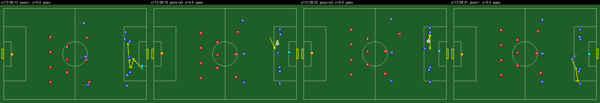 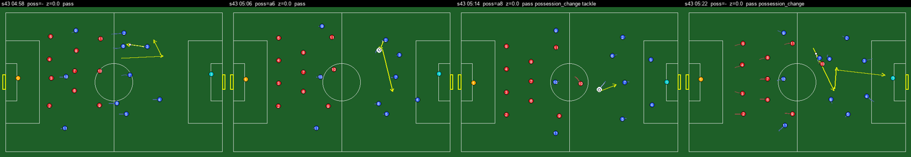 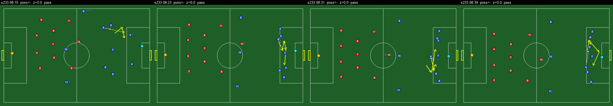 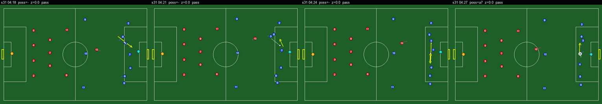 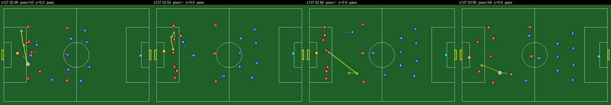 |
| 2 | 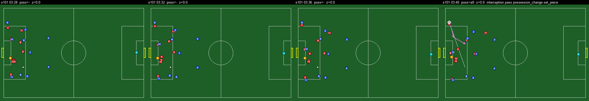 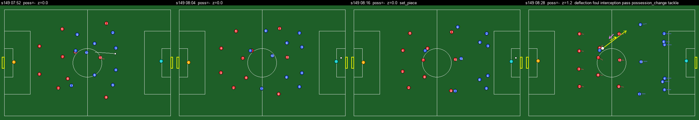 |
| 3 | 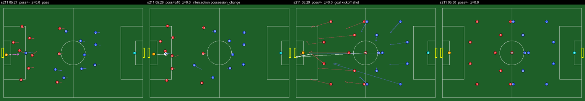 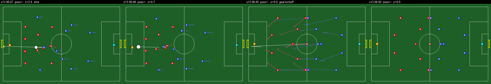 |
| 4 | 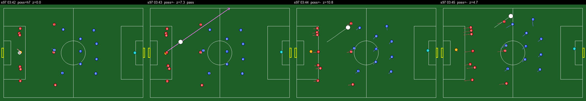 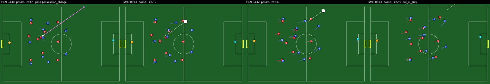 |
| 5 | 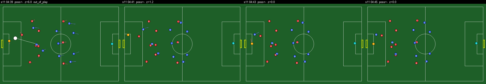 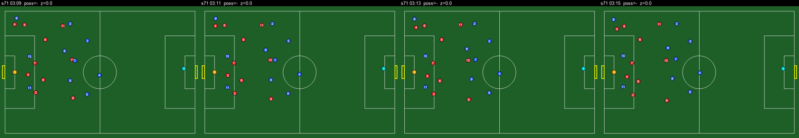 |
| 6-9 | 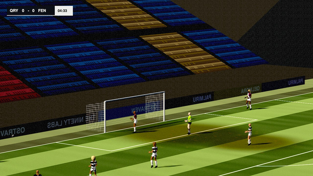 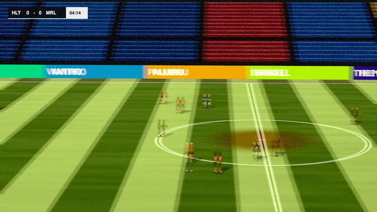 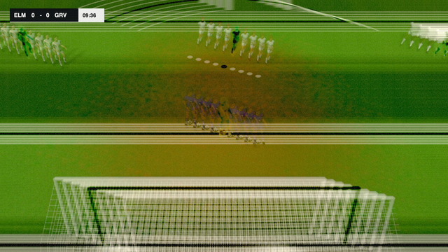 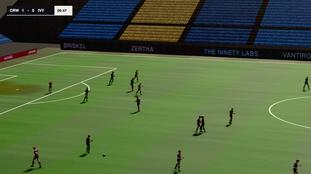 |
| 11 | 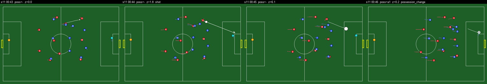 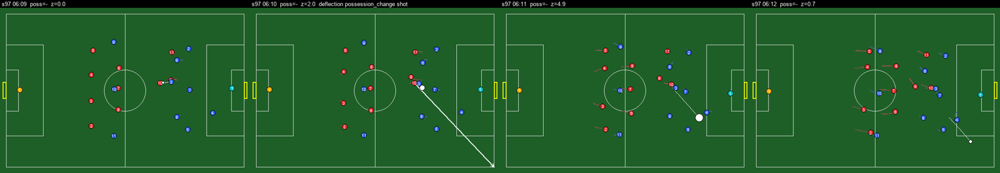 |
| 12 | 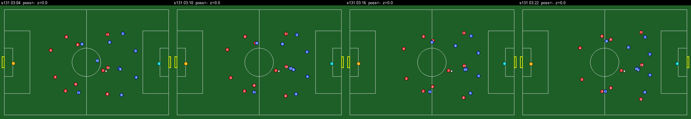 |
| 13 | 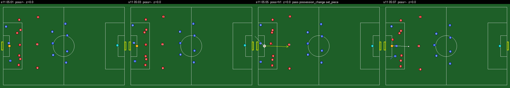 |

## Reproduce

```bash
uv run ninety-sim --seed 7 --minutes 10 --out runs/sweep/m/seed7
```

```bash
uv run --with pillow python scripts/defect_sweep/tactical.py runs/sweep/m/seed7 runs/sweep/tac
```

```bash
uv run ninety-render --seed 7 --start 362 --seconds 15 --out runs/sweep/b/seed7_362
```

```bash
uv run --with pillow python scripts/defect_sweep/bsheet.py runs/sweep/b/seed7_362 runs/sweep/bsheets/seed7_362.png
```

```bash
uv run python scripts/defect_sweep/measure.py
```

The reviewer and verifier briefs are `scripts/defect_sweep/REVIEWER_BRIEF.md` and
`VERIFIER_BRIEF.md`; every reviewer row is in `defect-sweep-7ee8720/reviews.json` and every
verdict in `defect-sweep-7ee8720/verify.json`. `scripts/defect_sweep/aggregate.py` maps the
reviewers' free-form type names onto the rows above. Broadcast windows: seed and start second
7 362, 13 239, 29 273, 37 569, 42 196, 42 515, 43 580, 71 399, 71 439, 83 381, 97 253, 97 319,
101 264, 101 325, 163 207, 163 454, 211 518, 257 355, 257 379, 293 216.
